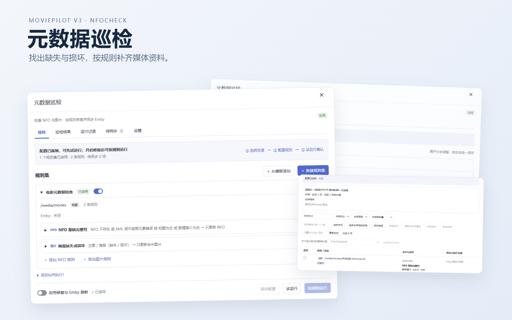
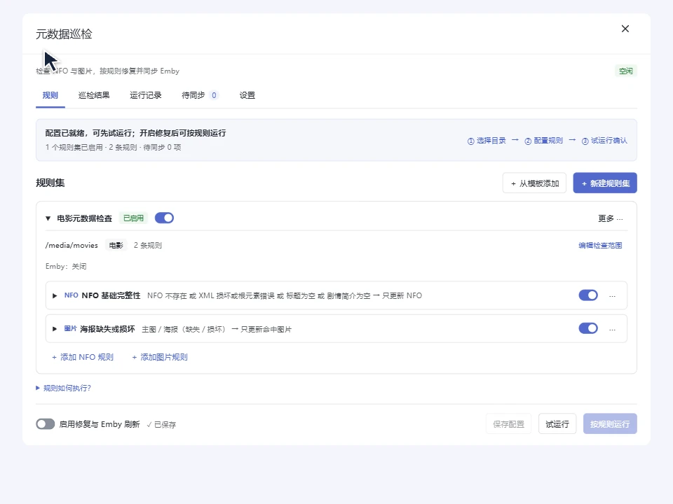

# 元数据巡检 NfoCheck

检查媒体库中的 NFO 和图片，按规则补刮，支持 Emby 定向刷新。



适用于 MoviePilot V3 3.2.5 及以上 · 当前版本 1.2.10

[安装](#安装) · [使用说明](#使用说明) · [Emby 联动](#emby-联动) · [常见问题](#常见问题) · [下载安装包](#下载安装包)

## 功能

| 检查对象 | 检查内容 | 处理方式 |
| --- | --- | --- |
| NFO | 文件缺失、XML 损坏、字段为空、长度不足、来源 ID 缺失等 | 仅报告，或重新生成 NFO |
| 图片 | 海报、背景图等缺失、损坏，或宽高不足 | 补齐命中的图片，或更新指定类型 |
| 文字语言 | 标题、简介等缺少目标语言内容 | 配合[元数据翻译](https://github.com/JKRaks/mpp-nfotrans)补齐所选字段 |
| Emby | 本地文件修改后需要更新显示 | 定向刷新，查看同步结果 |

检查范围可按目录和媒体类型设置，支持电影、整部剧、季、单集。不同目录可以使用不同的规则集。

所有启用的规则独立判断，命中的动作合并执行。身份或季集号冲突只记录问题，需要人工确认。

## 安装

在 MoviePilot 插件市场添加以下仓库，安装“元数据巡检”（插件标识 `NfoCheck`）：

```text
https://github.com/JKRaks/mpp-nfochecker
```

仓库已包含前端构建产物，无需自行编译。

## 使用说明

动图中的目录、媒体和结果均为示例数据，界面来自插件实际前端。MoviePilot 的主题可能影响显示效果。

### 1. 配置检查范围

在“规则”页面点击“从模板添加”，选择“NFO 基础完整性”或“图片缺失或损坏”。点击“编辑检查范围”，填写目录并选择媒体类型。首次使用建议选一个小目录。



检查目录每行一个，必须填写 MoviePilot 能访问的绝对路径。Docker 部署使用容器内路径，例如 `/media/movies`，不要填写未挂载的宿主机路径。

“高级范围选项”可设置排除目录、路径正则，也可以排除 Season 0。

### 2. 添加检查条件

点击规则名称展开编辑。NFO 规则可以检查文件缺失、XML 损坏和必填字段；“添加字段”用于补充要检查的字段，“添加高级条件”用于设置长度、正则等条件。图片规则则按图片类型检查缺失、损坏和尺寸。

例如，检查简介是否少于 50 字：点击“添加高级条件”，选择“字段长度小于”和“剧情简介”，条件值填 `50`。


“任一满足”和“全部满足”决定同一条规则中的条件关系。右侧“命中动作”决定发现问题后如何处理：

- “仅报告”：记录问题，不修复文件。
- “只更新 NFO”：重新生成整份 NFO。原文件有手工修改时，应检查备份设置。
- “只更新命中图片”：仅用于图片规则，不会因为一张海报缺失就更新所有图片。

### 3. 查看试运行结果

点击页面底部的“试运行”。配置有改动时，按钮显示“保存并试运行”，点击后会保存配置并开始检查。


试运行生成巡检记录，不修改媒体文件，也不刷新 Emby。“巡检结果”显示每个条目的命中原因和处理动作，支持按路径、状态、媒体层级和规则集筛选。

### 4. 设置运行前备份策略

在“设置”页面展开“备份”。NFO 备份默认开启，图片备份默认关闭；需要保留被替换的图片时，勾选“覆盖图片前备份”。保留天数和每文件版本数可分别调整。


开启备份后，备份失败的文件不会被覆盖。已有备份可在“设置 → 备份恢复”中查看和恢复。

配置完成后，开启“启用修复与 Emby 刷新”，保存配置，在“规则”页面点击“按规则运行”。也可以在“巡检结果”中勾选部分条目，使用“修复选中”。

## Emby 联动

Emby 联动默认关闭。使用时需要同时选择服务和规则集的刷新方式：

1. 在 MoviePilot 中配置并启用 Emby 服务，然后到插件“设置 → Emby 联动”中勾选该服务。
2. 在规则集的“编辑检查范围”中，选择“本地修改后刷新”，或“修改后刷新，并检查 Emby 显示缺失”。

MoviePilot 与 Emby 使用不同媒体路径时，在“媒体库与路径映射”中添加对应关系。插件只发送定向刷新请求，同步状态显示在巡检结果中。

“待同步”页面支持重试同步、移出单条任务和批量移出本页选中任务。移出仅清理当前队列，媒体文件、备份、同步回执和历史记录都会保留。以后再次触发同步时，条目仍可能入队；任务运行期间不能移出。

## 日常使用

| 操作 | 位置 |
| --- | --- |
| 查看问题和修复结果 | 巡检结果 |
| 查看历史任务 | 运行记录 |
| 达到批次上限后继续处理 | 巡检结果 → 继续剩余任务（一批） |
| 调整每批上限、自动继续和通知 | 设置 |
| 恢复文件 | 设置 → 备份恢复 |
| 定时巡检 | MoviePilot 工作流 |

试运行记录不能直接“继续剩余任务”，需要按规则正式运行，或选择条目执行修复。遇到“等待文件稳定”“冷却中”“待人工处理”等状态时，可在条目中查看具体原因。

### 元数据翻译

[元数据翻译](https://github.com/JKRaks/mpp-nfotrans)负责寻找已有译文、繁简转换和调用翻译服务；巡检负责检查媒体、按配置备份、写入文件和同步 Emby。

在翻译插件中配置策略后，到巡检规则中选择语言条件、翻译策略和处理字段。云端翻译需要自行配置 API Key，仓库不包含个人设置或密钥。

## 常见问题

### “按规则运行”为什么不能点击？

需要开启“启用修复与 Emby 刷新”，并至少启用一个配置完整的规则集。检查目录、媒体类型或检查条件为空时，页面会提示补充配置。任务执行期间也不能再次启动。

### 文件已经修好，Emby 为什么没有更新？

检查设置页是否已选择 Emby 服务、规则集是否开启联动，以及路径映射是否正确。“刷新已提交”表示请求已发送，仍需查看后续同步结果；未完成的条目可在“待同步”中重试。

### 可以只检查、不修改文件吗？

可以，使用“试运行”。如果某条规则只需记录问题，将它的“命中动作”设为“仅报告”。

## 下载安装包

版本安装包和 SHA256 校验文件见 [Releases](https://github.com/JKRaks/mpp-nfochecker/releases)。

最新构建见 [Actions](https://github.com/JKRaks/mpp-nfochecker/actions/workflows/package.yml)：进入成功的运行记录，从 Artifacts 下载。构建附件保留 30 天。
