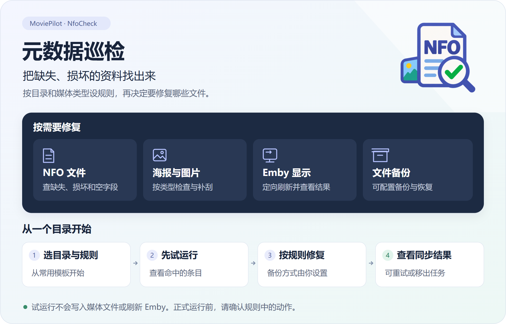

# 元数据巡检 NfoCheck

媒体入库后，偶尔会遇到海报没下载完整、NFO 缺少简介，或者本地已经修好、Emby 里却还没更新的情况。元数据巡检用你设定的规则找出这些条目，再按规则补刮 NFO 或图片，并通知 Emby 刷新。

适用于 MoviePilot V3（3.2.5 及以上），当前版本 1.2.10。

## 它能处理什么

| 遇到的情况 | 可以怎么处理 |
| --- | --- |
| NFO 不存在、XML 损坏，或标题、简介等字段为空 | 用 NFO 规则检查，命中后更新 NFO |
| 海报、背景图等图片缺失、损坏或尺寸不足 | 选择要检查的图片类型，只更新命中或指定的图片 |
| 本地文件已修好，Emby 显示仍未更新 | 配置 Emby 联动，发送定向刷新请求，并查看同步结果 |
| 想分目录使用不同标准 | 为目录建立规则集，分别选择媒体类型、排除范围和修复动作 |
| 简介缺少目标语言 | 配合元数据翻译插件，补齐选中的文字字段 |

电影、整剧、季和单集可以分别设置检查范围。所有启用的规则独立判断，命中的动作会合并执行。

## 安装

在 MoviePilot 插件市场添加仓库 `https://github.com/JKRaks/mpp-nfochecker`，然后安装“元数据巡检”。插件标识为 NfoCheck，仓库包含当前版本的完整前端产物。

检查目录要填写 MoviePilot 能访问的绝对路径。使用 Docker 时，请填写容器内的媒体路径。

## 第一次使用

1. 打开“规则”，从“NFO 基础完整性”或“图片缺失或损坏”模板创建规则集，填好检查目录。规则集先显示摘要，需要修改时再展开。
2. 选择媒体类型和检查条件，确认命中后要执行的动作，然后保存。常用条件可以直接勾选，自定义字段和高级条件按需展开。
3. 点击“试运行”，到“巡检结果”确认哪些条目会命中。试运行不会写入媒体文件，也不会刷新 Emby。
4. 到“设置”确认备份方式；需要同步 Emby 时，选择服务，并在规则集中开启联动。确认后启用修复，点击“按规则运行”。

第一次可以先选一个小目录，看看结果是否符合自己的预期。有未保存的修改时，页面会提醒先保存。

## 日常查看和管理

“巡检结果”用于查看发现的问题，“运行记录”保留每次执行的情况。任务可以分批处理，未完成的任务可继续执行；批次上限、自动继续和通知方式都在“设置”中调整。定时运行使用 MoviePilot 工作流配置。

“待同步”里可以重试 Emby 同步，也可以移出单条任务或勾选本页后批量移出。移出只清理当前队列，媒体文件、备份、同步回执和历史记录都会保留。以后再次触发同步时，条目仍可能重新入队；任务运行期间不能移出。

备份可以在“设置”中查看和恢复。开启备份后，如果某个文件备份失败，插件会跳过对它的覆盖。重建 NFO 会更新整份文件，运行前请确认规则中的动作。

## 和元数据翻译一起用

[元数据翻译](https://github.com/JKRaks/mpp-nfotrans)负责寻找已有译文、繁简转换和调用翻译服务；巡检负责检查现有媒体、按配置备份、写入文件和同步 Emby。

需要这项功能时，先在翻译插件里配置策略，再在巡检规则中选择语言条件和翻译动作。云端翻译所用的 API Key 需要自行配置，个人设置和密钥不随仓库提供。

## 下载安装包

已发布的 ZIP 和 SHA256 校验文件在 [Releases](https://github.com/JKRaks/mpp-nfochecker/releases)。

想使用最新构建，可以打开 [Actions](https://github.com/JKRaks/mpp-nfochecker/actions/workflows/package.yml)，进入成功的运行记录，从 Artifacts 下载。构建附件保留 30 天。
